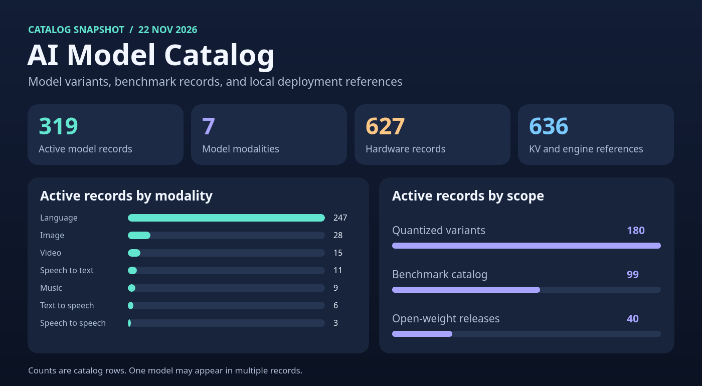

# Private AI Model Catalog

Use this repository to compare model benchmarks, find downloadable model variants, and assess local deployment requirements. The current release contains 319 active model records and 3,211 historical records. A model can have multiple records for different releases, evaluation settings, or weight formats.

## Catalog snapshot



## Quick start

1. Clone the private repository or download the [current catalog ZIP](https://github.com/mmahdi-sz/ai-model-catalog/releases/download/v2026.11.22/AI_Master_Ecosystem_Private_Upgraded_2026-11-22.zip).
2. Extract the archive and open `02_Master_AI_Models_Unified.csv` in a spreadsheet or CSV reader using UTF-8. In a terminal, you can run:

   ```sh
   unzip AI_Master_Ecosystem_Private_Upgraded_2026-11-22.zip -d catalog
   ```

3. Filter by model type, name, or precision. Use the benchmark label and methodology version when comparing scores. Check `01_Hardware_And_OS_VRAM.csv` for the device and `03_KVCache_And_Engines_Reference.csv` for context and engine considerations.

## Common workflows

- **Compare model quality.** Check `Primary_Score_Numeric` alongside `Primary_Benchmark_Label`. For a variant, `Base_Intelligence_Score` describes the base model and `Variant_Measured_Score` describes the exact variant when a measurement is available. Compare like metrics and versions.
- **Find weights to download.** Look up the model's `Catalog_ID` in `07_Weight_Manifest.csv`. Each matching row gives a filename, byte count, pinned revision, and download URL. A split checkpoint requires its full file set. If there is no manifest, use `Repository_URL` or `Repo_Or_Download_URL` to inspect the release and check `Weight_Verification` before selecting files.
- **Estimate whether a model fits.** Compare device capacity with the model's VRAM evidence and check the relevant KV cache settings. Weight-file size, publisher-reported GPU capacity, minimum VRAM, and measured peak usage have different meanings. A blank numeric cell indicates that a value is unavailable for that field.
- **Trace a benchmark.** Join `08_Benchmark_History.csv` and `05_Source_Row_Map.csv` on `Input_ID` to find its original row and any active destination.

## Main CSVs

| File | Use |
|---|---|
| `01_Hardware_And_OS_VRAM.csv` | Look up device memory and bandwidth. |
| `02_Master_AI_Models_Unified.csv` | Find models, compare benchmarks, and check weights and deployment requirements. |
| `03_KVCache_And_Engines_Reference.csv` | Check KV cache behavior and inference engine settings. |

The archive also includes supporting audit files for tracing historical benchmarks and weight evidence. See [SKILL.md](SKILL.md) for those lookups.

## Use with an AI agent

Give the agent this repository or the extracted ZIP, plus the [model catalog skill](SKILL.md). The skill explains which tables to read, how to join them, and how to report evidence.

> Read the model catalog SKILL.md. Find three models for a 24 GB GPU with the specified context length. Show the exact variant, comparable benchmark evidence, VRAM evidence, and pinned download files where available.
